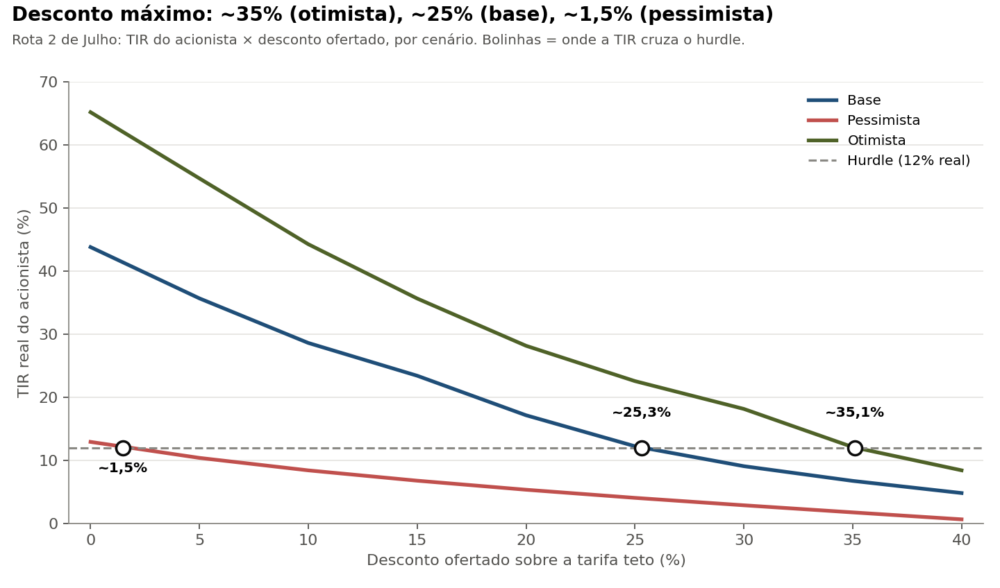
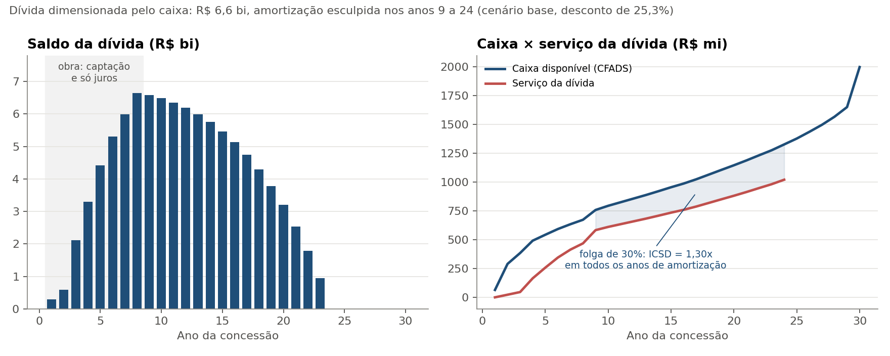

# Leilões de rodovias federais: quanto vale ganhar a Rota 2 de Julho?

[](https://colab.research.google.com/github/marialuisagama/leiloes-rodovias/blob/main/triagem_leiloes.ipynb)

**Pergunta:** entre os leilões de rodovias federais recentes e previstos, qual é o mais atraente para um investidor de equity de infraestrutura, e quanto vale ganhar esse leilão?

**Resposta curta:** escolhi a **Rota 2 de Julho** (BR-116 e BR-324, na Bahia; leilão em 18/12/2026). Um investidor que exige **12% de retorno real** pode oferecer até **~25% de desconto** sobre a tarifa teto. Mas esse número é frágil: com 10% menos tráfego e 15% mais capex do que o estudo do governo prevê, o desconto viável cai para **perto de zero**. Quem vencer com um lance agressivo está apostando que o estudo está certo.



O projeto tem duas partes:

| Parte | Ferramenta | Arquivo |
|---|---|---|
| 1. Triagem: o que explica o desconto nos leilões passados e qual lote estudar | Python (Colab) | [`triagem_leiloes.ipynb`](triagem_leiloes.ipynb) |
| 2. Modelo de project finance: quanto um investidor pode oferecer | Excel | [`modelo/modelo_rota_2_de_julho.xlsx`](modelo/modelo_rota_2_de_julho.xlsx) |

---

## 1. Triagem (Python)

Montei uma base com **22 leilões federais** de rodovias (18 realizados entre 2023 e 2026 e 4 previstos), com dados da ANTT e da imprensa especializada ([`dados/leiloes_rodovias.xlsx`](dados/leiloes_rodovias.xlsx)).

**O que aprendi**
- **A concorrência explica a maior parte do desconto.** Com uma proposta, o desconto fica perto de zero; com três ou mais, quase sempre entre 14% e 27%.
- **Características do lote não explicam o desconto:** capex por km, tamanho do investimento, peso da duplicação e TIR de referência têm correlações fracas (entre −0,3 e +0,2).
- **Nem a economia da região nem o tráfego previram a concorrência.** Para testar isso, comparei quatro finalistas usando o PIB municipal do IBGE e os estudos de tráfego dos editais. A Rota Agro Norte, por exemplo, tem mais tráfego e renda maior que a Rota das Gerais, mas teve uma única proposta, contra três na Gerais.

**Consequência para o modelo:** se o desconto não é previsível pelos fundamentos, não faz sentido tratá-lo como premissa. O modelo calcula o **desconto máximo** que um investidor pode oferecer e compara com as faixas históricas: ~0% sem disputa, ~15% com disputa moderada e ~25% com disputa forte.

**Por que a Rota 2 de Julho:** é o único finalista ainda não leiloado, o que permite uma previsão "ao vivo". É também o maior lote em capex (R$ 14,8 bi) e o de maior tráfego.

## 2. Modelo de project finance (Excel)

**Ponto de partida:** o modelo econômico-financeiro do próprio governo (MEF, versão de 01/09/2026), que gerou a tarifa teto. Copiei as séries anuais de tráfego, receita, opex e capex e reconstruí o fluxo de caixa do projeto.

**Calibração:** com desconto zero, a TIR do projeto do meu modelo dá **12,45%**, contra os **12,49%** do governo. Os 0,04 p.p. de diferença vêm de uma simplificação no cálculo do IR. A TIR de referência do governo é a TLP (7,55%) somada a um spread de risco de 4,94%, que sai de uma matriz de notas da ANTT.

**O que acrescentei: a estrutura de financiamento**
- **Dívida dimensionada pelo caixa:** o serviço da dívida em cada ano é o caixa disponível (CFADS) dividido pelo **ICSD mínimo de 1,30x**. A dívida é o valor presente dessas parcelas.
- **Amortização esculpida:** a parcela acompanha o caixa, então o ICSD fica em 1,30x em todos os anos de amortização (9 a 24).
- **Carência durante a obra** (anos 1 a 8, quando o capex chega a R$ 2,4 bi por ano) e **alavancagem máxima de 70%** do capex da obra.
- **Custo real da dívida de IPCA + 7,8%**, calibrado com debêntures incentivadas recentes de rodovias.
- **Lock-up:** durante a obra, nenhum dividendo é distribuído; o caixa excedente fica retido e é liberado quando começa a amortização.
- **Desconto máximo** encontrado com o Atingir Meta: o desconto que faz a TIR do acionista igualar o hurdle de 12% real.



Todas as premissas ficam numa aba, com fonte. Um seletor troca entre os cenários base, pessimista e otimista, e uma aba de checagens confirma que o modelo fecha em qualquer cenário: a dívida é quitada, o ICSD nunca fica abaixo do mínimo e o caixa retido é todo liberado.

## 3. Resultados

| Cenário | Premissas | Desconto máximo (hurdle 12%) |
|---|---|---|
| Otimista | Tráfego +5%, capex −5%, opex −5%, dívida −1 p.p. | ~35% |
| **Base** | Estudos do governo | **~25%** |
| Pessimista | Tráfego −10%, capex +15%, opex +10%, dívida +1 p.p. | ~1,5% |

**Qual risco pesa mais?** Mudando um fator por vez a partir do cenário base:

| Choque isolado | Desconto máximo |
|---|---|
| Capex +15% | 16% |
| Tráfego −10% | 17% |
| Custo da dívida +1 p.p. | 22,5% |
| Opex +10% | 24% |

Tráfego e capex dominam. E os choques combinados pioram mais do que a soma dos isolados: menos caixa significa menos dívida, o que obriga o acionista a colocar mais capital caro.

O resultado também depende do retorno exigido: com hurdle de 10%, o desconto máximo sobe para ~28%; com 14%, cai para ~23%.

## 4. O que isso diz sobre o leilão de 18/12

- Se três ou quatro grupos com custo de capital parecido disputarem, o lance vencedor tende a ficar **perto de 25%**, o que deixa pouca sobra de valor para quem ganha.
- Se a disputa for fraca, o vencedor captura um valor grande: com desconto zero, a TIR do acionista passaria de 40%.
- Em qualquer caso, vale a **maldição do vencedor**: quando todos olham os mesmos estudos, tende a vencer quem está mais otimista sobre tráfego e obra.

*Vou atualizar esta seção com o resultado do leilão.*

## 5. Limitações

- **Termos reais:** o modelo não projeta inflação, como o MEF; a dívida entra como IPCA + spread.
- **Séries herdadas:** receita, opex e capex vêm do modelo do governo, sem revisão independente de engenharia ou tráfego.
- **Tráfego não reage à tarifa:** com desconto, o tráfego seria um pouco maior, então a premissa é conservadora.
- **Evasão do free flow:** segue o tratamento do MEF, em que o poder concedente cobre 90% da inadimplência.
- **Simplificações de dívida:** sem conta reserva, fees ou juros capitalizados; taxa única para toda a dívida.
- **Triagem:** poucos leilões por grupo; as conclusões são indícios, não testes estatísticos. Algumas listas de municípios e definições de tráfego são aproximadas.

## Estrutura do repositório

```
├── README.md
├── triagem_leiloes.ipynb          # parte 1: triagem em Python
├── dados/
│   └── leiloes_rodovias.xlsx      # base de leilões, região (IBGE) e notas
├── modelo/
│   └── modelo_rota_2_de_julho.xlsx  # parte 2: modelo de project finance
└── figuras/                       # gráficos do README e do notebook
```

## Fontes

- ANTT, páginas dos projetos de concessão: https://www.gov.br/antt/pt-br/assuntos/rodovias/novos-projetos-em-rodovias
- Modelo econômico-financeiro (MEF) e estudos da Rota 2 de Julho, data room da ANTT
- Estudos de demanda da Rota das Gerais, do Paraná Lote 3 e da Rota Agro Norte (CN5), data rooms da ANTT e do BNDES
- IBGE, PIB dos Municípios (base 2010-2023)
- Imprensa especializada (Agência iNFRA, Poder360, NeoFeed e outras) para vencedores, descontos e número de propostas; a fonte de cada leilão está na planilha

---

Maria Luísa Gama · FGV EAESP · outubro de 2026
*Modelo de estudo feito com dados públicos; não é recomendação de investimento.*
